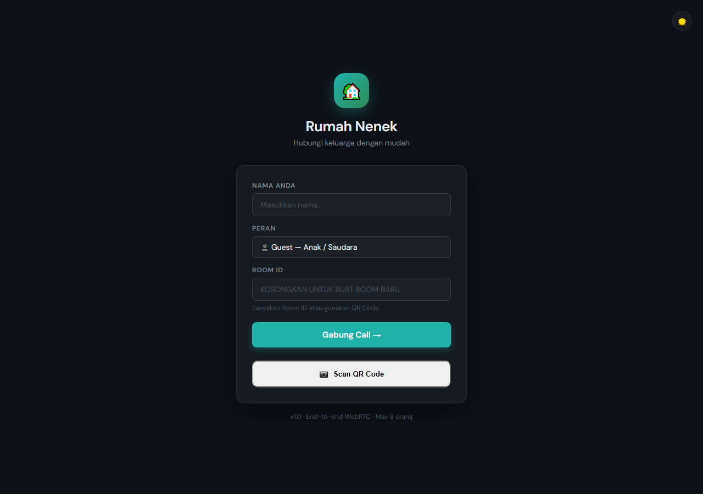
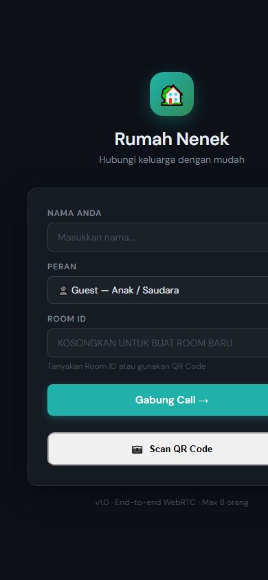
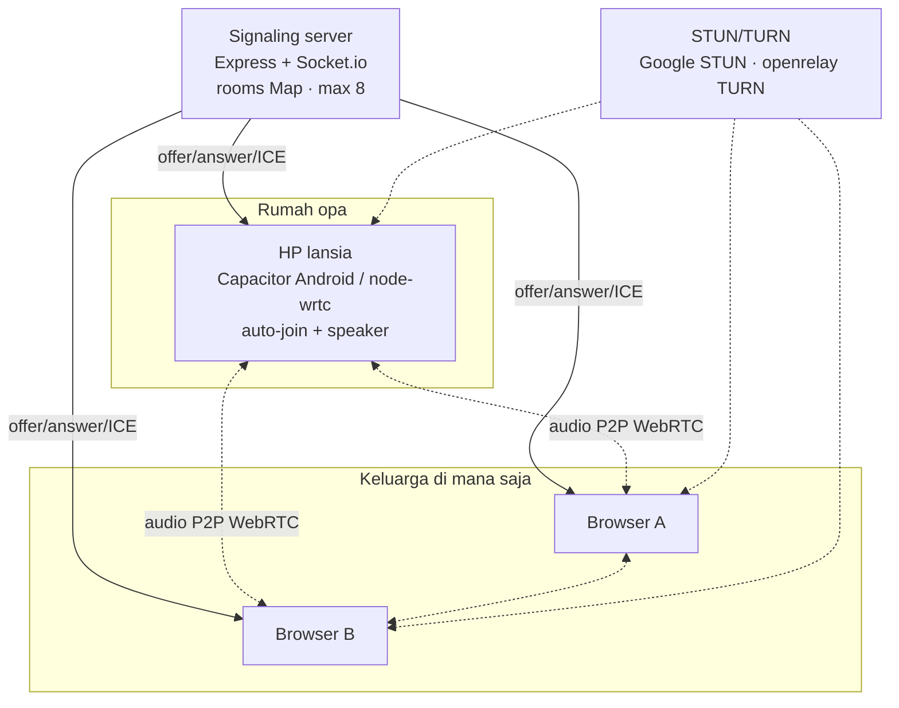

# rumah-nenek — Telepon Keluarga untuk Kakek-Nenek

**Panggilan suara keluarga berbasis WebRTC: HP kakek-nenek auto-connect, keluarga tinggal gabung lewat browser.**

---

## Tampilan

### Desktop

### Mobile

---

## Masalahnya

- Kakek-nenek tidak bisa/kurang nyaman pakai WhatsApp — harus buka app, cari kontak, tekan tombol panggil
- Keluarga yang jauh ingin **sekadar dengar suara** opa/bu di rumah kapan saja, tanpa proses rumit di sisi lansia
- Aplikasi video call berat untuk HP lama & boros kuota — yang dibutuhkan cuma **audio**

## rumah-nenek

**"Telepon rumah" digital:** sebuah perangkat lansia (HP Android dengan app Capacitor / node client) berada di ruang keluarga dan **selalu terhubung ke room**. Anggota keluarga lain cukup buka link di browser mana pun → masuk room → langsung ngobrol. Audio WebRTC peer-to-peer, server cuma signaling.

### Fitur

- **Room keluarga** — kode room 6 karakter, maksimal 8 peserta (mesh P2P yang wajar)
- **Mode lansia** — client `elder` auto-join dengan nama, tanpa interaksi rumit; app Android berbasis Capacitor + permission handler
- **Browser client** — keluarga gabung dari HP/laptop via `public/` web client, tanpa install
- **Node elder client** — alternatif perangkat khusus: `wrtc` (node-webrtc) dengan `RTCAudioSink/Source`, speaker output langsung, konfigurasi STUN Google + TURN openrelay (fallback NAT ketat)
- **Signaling Socket.io** — ping/timeout disetel untuk jaringan rumah yang flaky, CORS terbuka untuk jaringan keluarga
- **Siap produksi** — `ecosystem.config.json` (PM2), TS types, dev/start scripts

---

## Arsitektur

- **Stack:** Node.js + Express · Socket.io · WebRTC (browser native + `wrtc` untuk client lansia Node) · Capacitor (Android wrapper) · speaker npm
- **Keunggulan desain:** kompleksitas ditaruh di sisi teknologi, **nol di sisi lansia** — perangkat lansia cuma perlu tetap menyala dan terhubung WiFi

---

## English

**rumah-nenek** is a family voice-call app built on WebRTC. The grandparents' phone connects automatically, and the rest of the family joins from a browser — no app install, no account setup on their side.

It is designed for families who want a fixed line to elderly parents without teaching them new software.

The source code is not published; this repository documents the product.

---

## Tentang Source Code

Repository ini adalah **showcase** — dokumentasi produk, bukan kode sumber.
Source code rumah-nenek tidak dipublikasikan dan semua hak dilindungi. Lihat [`LICENSE`](LICENSE).

> Demo, kolaborasi, atau lisensi? Hubungi [Kandar Lubis](https://github.com/kandarlubis31).

---

© 2026 Kandar Lubis — All Rights Reserved.
